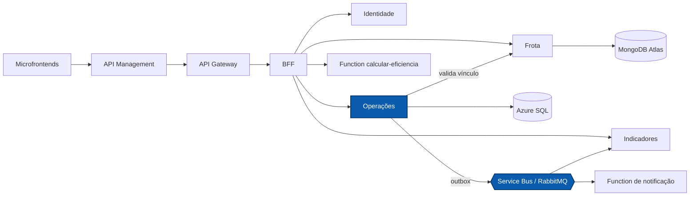

# NexFleet Operações

Microsserviço operacional do NexFleet: registra, consulta, edita e exclui abastecimentos e manutenções, protege o hodômetro de cada veículo e publica eventos de forma confiável pelo padrão outbox.

[](https://github.com/mateusblm/nexfleet-operacoes/actions/workflows/ci.yml)
[](https://hub.docker.com/r/mateusblm/nexfleet-operacoes)


---

## Visão geral

O NexFleet é uma plataforma de gestão de frotas empresariais: veículos, motoristas, vínculos, abastecimentos, manutenções, painel de custos e uma visão consolidada de eficiência.

**Operações** guarda o histórico operacional da frota no **Azure SQL** (schema `operacoes`, usuário de banco exclusivo, migrações Flyway). Antes de registrar, consulta Frota para validar o veículo e o vínculo motorista ↔ veículo. O abastecimento, a atualização do hodômetro e o evento de saída são gravados **na mesma transação**; um job publica a outbox no **Azure Service Bus** (nuvem) ou no **RabbitMQ** (local), de onde Indicadores e a Function de notificação consomem. O BFF lê os históricos daqui para o `GET /aggregated-data` e a Function `calcular-eficiencia`.



## Funcionalidades

- Registro, listagem paginada (com filtro por veículo), consulta por id, edição e exclusão de abastecimentos.
- Abastecimento só com vínculo motorista ↔ veículo válido na data, conferido em Frota.
- Hodômetro que **nunca regride**: quilometragem menor que a atual é recusada, com bloqueio de linha (`UPDLOCK, ROWLOCK`) contra corridas.
- Data de abastecimento no futuro recusada.
- Edição do abastecimento restrita a combustível, litros, valor total e quilometragem; data, veículo e motorista ficam fixos (para mudá-los, exclui-se e registra-se de novo). A nova quilometragem precisa ficar estritamente entre a do abastecimento anterior e a do seguinte do mesmo veículo, e o hodômetro é recalculado pelo maior km restante na edição e na exclusão.
- Registro e listagem paginada de manutenções (`PREVENTIVA`, `CORRETIVA`, `REVISAO`, `TROCA_OLEO`, `TROCA_PNEUS`, `OUTROS`), com data de próxima manutenção opcional e posterior à atual; veículo precisa existir e estar ativo. Consulta por id, edição (todos os campos com as regras do cadastro, menos o veículo) e exclusão.
- Edição e exclusão com os mesmos perfis do registro (`ADMINISTRADOR` e `GESTOR_FROTA`); exclusão definitiva, com rastro no evento (`excluidoPor`, `excluidoEm`) e no log.
- **Versão por registro**: começa em 1, cada edição soma 1 e a exclusão publica a versão atual + 1.
- **Outbox transacional**: registro e evento gravados juntos; publicação em lotes com leitura concorrente segura (`UPDLOCK, READPAST`) e nova tentativa após falha.
- Eventos versionados `AbastecimentoRegistrado`, `AbastecimentoAtualizado`, `AbastecimentoExcluido`, `ManutencaoRegistrada`, `ManutencaoAtualizada` e `ManutencaoExcluida` (todos v1), com transporte selecionável: Service Bus (tópico `nexfleet-eventos-v1`, identidade gerenciada) ou RabbitMQ (exchange `nexfleet.eventos`, com confirmação de publicação).
- Readiness ligado ao banco: sem SQL disponível, responde `503`.

## Arquitetura

**Clean Architecture + Vertical Slice.** Cada caso de uso é uma fatia em `br.com.nexfleet.operacoes`. As regras de negócio puras ficam em `domain` (sem Spring, JDBC nem Jackson); `application` orquestra os casos de uso e define as portas; `infrastructure` e `api` são adaptadores.

| Fatia | Camadas | Responsabilidade |
|---|---|---|
| `registrarabastecimento` | `api`, `application`, `domain`, `infrastructure` | Registrar, consultar, editar e excluir abastecimentos; hodômetro; validação do vínculo em Frota |
| `registrarmanutencao` | `api`, `application`, `domain`, `infrastructure` | Registrar, consultar, editar e excluir manutenções; validação do veículo em Frota |
| `publicareventos` | `application`, `infrastructure` | Publicar a outbox no Service Bus ou no RabbitMQ |
| `consultarservico` | `api`, `application`, `infrastructure` | Informações do serviço e verificação do banco |

No `domain` ficam `TipoManutencao`, as validações do cadastro e da edição (`DetalhesManutencao`, `MedicaoAbastecimento`), a faixa de quilometragem entre vizinhos (`FaixaQuilometragem`), a regra do hodômetro e o cálculo da versão. `publicareventos` e `consultarservico` são técnicos e não têm `domain`.

Pacotes técnicos: `config` (segurança, JWKS, OpenAPI e composição) e `observability` (correlação).

Regras verificadas pelo ArchUnit (`ArchitectureTest`):

- `domain` não depende de `application`, `infrastructure`, `api`, `config`, Spring, Jakarta, JDBC nem Jackson;
- `application` não depende de Spring, JPA, `infrastructure` nem `api`;
- `api` não acessa `infrastructure` nem JDBC diretamente;
- nenhuma classe importa código interno de outros serviços.

## API

Rotas internas do serviço. A aplicação web as consome pelo BFF, que as expõe sem o prefixo `/operacoes`.

| Método | Rota interna | Exposta pelo BFF como | Descrição |
|---|---|---|---|
| `GET` | `/api/v1/operacoes/abastecimentos?veiculoId=&pagina=&tamanho=` | `GET /api/v1/abastecimentos` | Listar abastecimentos (padrão: página 0, 20 itens) |
| `POST` | `/api/v1/operacoes/abastecimentos` | `POST /api/v1/abastecimentos` | Registrar abastecimento |
| `GET` | `/api/v1/operacoes/abastecimentos/{id}` | `GET /api/v1/abastecimentos/{id}` | Consultar abastecimento |
| `PUT` | `/api/v1/operacoes/abastecimentos/{id}` | `PUT /api/v1/abastecimentos/{id}` | Editar combustível, litros, valor total e quilometragem |
| `DELETE` | `/api/v1/operacoes/abastecimentos/{id}` | `DELETE /api/v1/abastecimentos/{id}` | Excluir abastecimento |
| `GET` | `/api/v1/operacoes/manutencoes?veiculoId=&pagina=&tamanho=` | `GET /api/v1/manutencoes` | Listar manutenções |
| `POST` | `/api/v1/operacoes/manutencoes` | `POST /api/v1/manutencoes` | Registrar manutenção |
| `GET` | `/api/v1/operacoes/manutencoes/{id}` | `GET /api/v1/manutencoes/{id}` | Consultar manutenção |
| `PUT` | `/api/v1/operacoes/manutencoes/{id}` | `PUT /api/v1/manutencoes/{id}` | Editar manutenção (menos o veículo) |
| `DELETE` | `/api/v1/operacoes/manutencoes/{id}` | `DELETE /api/v1/manutencoes/{id}` | Excluir manutenção |
| `GET` | `/api/v1/operacoes/info` | — | Informações do serviço |

As listagens também alimentam o `GET /aggregated-data` do BFF. O OpenAPI do serviço é publicado em `/v3/api-docs` e reunido na Swagger UI do Gateway: **[Swagger UI em produção](https://apim-nexfleet-homolog-ukzjodf42myfe.azure-api.net/swagger-ui.html)** (seletor "Operações").

### Eventos publicados

| Evento | Routing key (RabbitMQ) | Consumidores |
|---|---|---|
| `AbastecimentoRegistrado` v1 | `operacoes.abastecimento.registrado.v1` | Indicadores, Function de notificação |
| `AbastecimentoAtualizado` v1 | `operacoes.abastecimento.atualizado.v1` | Indicadores |
| `AbastecimentoExcluido` v1 | `operacoes.abastecimento.excluido.v1` | Indicadores |
| `ManutencaoRegistrada` v1 | `operacoes.manutencao.registrada.v1` | Indicadores |
| `ManutencaoAtualizada` v1 | `operacoes.manutencao.atualizada.v1` | Indicadores |
| `ManutencaoExcluida` v1 | `operacoes.manutencao.excluida.v1` | Indicadores |

Todos levam o campo `versao` (ausente vale 1). Na nuvem, os seis eventos vão para o tópico `nexfleet-eventos-v1` do Service Bus. Contrato completo na [página AsyncAPI](https://white-mushroom-0cadda010.3.azurestaticapps.net/docs/eventos/).

## Stack

| Camada | Tecnologia | Versão |
|---|---|---|
| Linguagem | Java | 21 |
| Framework | Spring Boot (Web MVC, Security, OAuth2 Resource Server, JDBC, AMQP, Actuator) | 4.1.1 |
| Banco de dados | Azure SQL / SQL Server (`mssql-jdbc`) | — |
| Migrações | Flyway (`flyway-sqlserver`) | gerenciada pelo Spring Boot |
| Mensageria | Azure Service Bus (`azure-messaging-servicebus`, `azure-identity`) / RabbitMQ | Azure SDK BOM 1.3.9 |
| Documentação | springdoc-openapi (`/v3/api-docs`) | 3.2.0 |
| Observabilidade | Micrometer + Prometheus | gerenciada pelo Spring Boot |
| Testes | JUnit 5, Testcontainers (SQL Server), ArchUnit | 5 / — / 1.4.1 |
| Build | Maven Wrapper | 3.9.16 |
| Contêiner | `eclipse-temurin:21-jre-jammy` | 21 |
| CI/CD | GitHub Actions → Docker Hub | — |

## Primeiros passos

### Pré-requisitos

- JDK 21 (o Maven vem pelo wrapper `./mvnw`)
- Docker, para os testes de integração (Testcontainers) e para executar a imagem

### Testes

```bash
./mvnw -B -ntp verify
```

### Executar com Docker

O serviço precisa de um SQL Server com o schema `operacoes` e um usuário de banco já criados, de um RabbitMQ (ou Service Bus) e dos serviços Identidade e Frota.

```bash
docker run --rm -p 8083:8080 \
  -e SPRING_PROFILES_ACTIVE=jwt-rsa \
  -e DB_URL="jdbc:sqlserver://<host>:1433;databaseName=<banco>;encrypt=true" \
  -e DB_USER=<usuário> \
  -e DB_PASSWORD=<senha> \
  -e IDENTIDADE_URL=http://<host-da-identidade>:8080 \
  -e FROTA_URL=http://<host-da-frota>:8080 \
  -e RABBITMQ_HOST=<host-do-rabbitmq> \
  -e RABBITMQ_USER=<usuário> \
  -e RABBITMQ_PASSWORD=<senha> \
  mateusblm/nexfleet-operacoes:v1.1.0
```

Para gerar a imagem a partir do código: `docker build -t mateusblm/nexfleet-operacoes:local .`

### Ambiente completo

O produto inteiro (todos os serviços, SQL Server, MongoDB e RabbitMQ) sobe pelo repositório [nexfleet](https://github.com/mateusblm/nexfleet), que também cria o banco, os schemas e os usuários de cada serviço:

```bash
git clone https://github.com/mateusblm/nexfleet.git && cd nexfleet
scripts/clonar-tudo.sh                                        # clona os demais repositórios ao lado
scripts/iniciar-local.sh                                      # gera o .env e a chave RSA local
docker compose -f compose.yaml -f compose.build.yaml up -d --build
scripts/seed-demo.sh                                          # dados de demonstração
```

## Configuração

| Variável | Descrição | Padrão |
|---|---|---|
| `PORT` | Porta HTTP | `8080` |
| `SPRING_PROFILES_ACTIVE` | `jwt-rsa` valida o token pela JWKS da Identidade | — |
| `DB_URL` | URL JDBC do SQL Server / Azure SQL | obrigatória |
| `DB_USER` | Usuário de banco do serviço | obrigatória |
| `DB_PASSWORD` | Senha do usuário de banco; segredo | obrigatória |
| `IDENTIDADE_URL` | URL da Identidade (JWKS) | `http://localhost:8081` |
| `FROTA_URL` | URL de Frota | `http://localhost:8082` |
| `MESSAGING_PROVIDER` | Transporte de eventos: `rabbit` ou `servicebus` | `rabbit` |
| `RABBITMQ_HOST` | Host do RabbitMQ | `localhost` |
| `RABBITMQ_PORT` | Porta AMQP | `5672` |
| `RABBITMQ_USER` | Usuário do RabbitMQ | `nexfleet` |
| `RABBITMQ_PASSWORD` | Senha do RabbitMQ; segredo | — |
| `SERVICEBUS_FULLY_QUALIFIED_NAMESPACE` | Namespace do Service Bus (autenticação por identidade gerenciada) | vazio |
| `SERVICEBUS_TOPIC` | Tópico do Service Bus | `nexfleet-eventos-v1` |

A publicação da outbox roda a cada 1 s (atraso inicial de 3 s), em lotes de 20, com nova tentativa após 5 s.

## Ambiente em nuvem

| Recurso | Endereço |
|---|---|
| Aplicação | https://white-mushroom-0cadda010.3.azurestaticapps.net |
| API (Azure API Management) | https://apim-nexfleet-homolog-ukzjodf42myfe.azure-api.net |
| Swagger UI | https://apim-nexfleet-homolog-ukzjodf42myfe.azure-api.net/swagger-ui.html |
| AsyncAPI dos eventos | https://white-mushroom-0cadda010.3.azurestaticapps.net/docs/eventos/ |
| Imagem Docker | https://hub.docker.com/r/mateusblm/nexfleet-operacoes |

Operações roda em Azure Container Apps, sem URL pública própria, com dados no Azure SQL e eventos no Azure Service Bus.

> Os serviços escalam a zero quando ociosos. A primeira requisição após um período de inatividade pode levar de 1 a 2 minutos.

## Testes

| Tipo | Exemplos | O que cobre |
|---|---|---|
| Unitários | `GerenciarAbastecimentosTest`, `GerenciarManutencoesTest`, `PublicarEventosPendentesTest` | Regras de registro, paginação e publicação da outbox |
| Publicadores | `RabbitPublicadorEventosTest`, `ServiceBusPublicadorEventosTest` | Envio dos eventos em cada transporte |
| Integração (Testcontainers, SQL Server) | `JdbcAbastecimentosIT`, `JdbcManutencoesIT`, `JdbcEventosOutboxIT`, `Cq05HistoricoVeiculoIT` | Persistência real, hodômetro, outbox e histórico por veículo |
| Arquitetura (ArchUnit) | `ArchitectureTest` | Dependências entre camadas e isolamento entre serviços |

```bash
./mvnw -B -ntp verify     # testes de integração exigem Docker
```

O CI (`.github/workflows/ci.yml`) executa `verify` a cada push e pull request; em tags `v*`, publica `mateusblm/nexfleet-operacoes:<tag>` e `:latest` no Docker Hub.

## Equipe

- Vinícius dos Reis Góes
- Mateus Burlamaqui
- Lucas Roussenq
- Erik Carvalho
